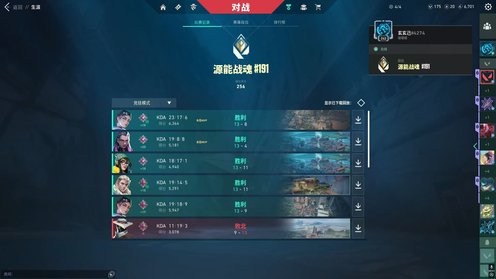

  

## 🦁 关于我

> 白天共建社群，晚上夜深人静做 AI 产品。

我一定在做这几件事中。

| 🤖 AI | 📚 哲学 | 🏃 运动 | 🎮 游戏 |
| --- | --- | --- | --- |
| BAYViS community、自媒体、各种 AI 产品 | 道教以及场、域、AI 与人的关系、高维宇宙 | 健身、篮球、步行 | 无畏契约、英雄联盟 |

## 📌 精选项目

🚧 在手：Kimmy v1.0.7（LuumiAI）— 轻具身智能玩宠、Luumi 通剪、听懂、狂想成像（为 TEDxShenzhen 定制 AI 图生图产品）、thought-to-3d-print（想啥印啥，全网有 1 万人关注浏览）

## 🧊 下班之后

AI 写代码，我健身、打篮球、打游戏、规划旅途、思考哲学、发呆。

---

📮 luumiai@163.com · 深圳南山
